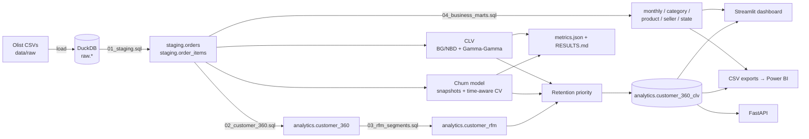

# RetailPulse — E-commerce Customer Intelligence Platform

End-to-end customer analytics on the **Olist Brazilian e-commerce dataset** (~100k orders):
a SQL warehouse, Customer 360, RFM segmentation, **probabilistic CLV (BG/NBD + Gamma-Gamma)**,
**leak-free churn prediction** with time-aware validation, retention prioritisation, a
4-page dashboard and a REST API — runnable with three commands.

```bash
pip install -e ".[dev]"
retailpulse download      # public Olist CSVs (~85 MB) -> data/raw/
retailpulse run           # warehouse -> models -> scored customers -> reports (~2-3 min)
retailpulse dashboard     # http://localhost:8501
```

No internet? `retailpulse run --synthetic` generates an Olist-shaped dataset and runs the
same pipeline.

## Business questions it answers
- Where does revenue come from (months, categories, states, segments)?
- Which customers are valuable, and how much will they spend in the next 12 months?
- Who is likely to stop buying, and what predicts it?
- **Who should the retention team contact first, and with what action?**

## Architecture



## Results on the real Olist data
Full, auto-generated report: **[reports/RESULTS.md](reports/RESULTS.md)**. Headlines:

- Only **3.0%** of 94,983 customers ever order twice; in a typical 120-day window under 1%
  of existing customers return. Retention is the growth lever.
- **Churn model:** Logistic Regression wins time-aware validation with ROC-AUC ≈ 0.61; its
  top-10% list finds returning customers at ≈ 2x the base rate. Review scores are among the
  strongest predictors. (Modest, but honest — return on a marketplace is close to random,
  and the old pipeline's "perfect" scores came from label leakage.)
- **CLV:** in a 180-day holdout, BG/NBD + Gamma-Gamma predicted total revenue within ~12%
  of actual; the original heuristic proxy over-forecast by ~350x.
- **Retention priority:** ~4.4k high-value / high-risk (P1) customers, each with a
  recommended action, exportable as a call list.

## Commands

| Command | What it does |
|---|---|
| `retailpulse download` | Download the public Olist dataset into `data/raw/` |
| `retailpulse generate` | Write a synthetic Olist-shaped dataset instead (offline) |
| `retailpulse run [--churn-horizon 120] [--folds 4]` | Build the warehouse, train and validate models, score every customer, write exports and reports |
| `retailpulse dashboard` | 4-page Streamlit dashboard |
| `retailpulse serve` | REST API (docs at `http://127.0.0.1:8000/docs`) |
| `retailpulse export-postgres --url ...` | Copy analytics tables to PostgreSQL (`pip install -e ".[postgres]"`) |

Or with Docker: `docker compose up --build` (downloads data, runs the pipeline, then starts
the API on :8000 and dashboard on :8501).

## Outputs (`artifacts/`, git-ignored)

| File | Contents |
|---|---|
| `warehouse.duckdb` | All raw, staging and analytics tables |
| `RESULTS.md`, `metrics.json` | Every metric from the run |
| `models/churn_model.joblib` | Final churn pipeline + metadata |
| `churn_cv_folds.csv`, `feature_importance.csv` | Validation detail |
| `exports/*.csv` | Power BI-ready tables (see `dashboard/POWERBI.md`) |

The key table is **`analytics.customer_360_clv`** — one row per customer with RFM scores,
segment, `predicted_12m_clv`, `p_alive`, `churn_probability`, `clv_at_risk`,
`retention_priority` and `recommended_action`.

## Dashboard
1. **Executive Overview** — revenue, orders, customers, AOV, growth; monthly trend; categories; states.
2. **Customer Intelligence** — active customers, repeat rate, CLV; segments; R×M heatmap; CLV distribution.
3. **Churn & Retention** — churn rate, high-risk and P1 counts, CLV at risk; value-vs-risk scatter; P1 call list (CSV download); model validation and feature importance.
4. **Product & Seller** — top categories and products; seller revenue concentration; review score vs revenue.

## API

| Endpoint | Description |
|---|---|
| `GET /health` | Status and whether the warehouse/model exist |
| `GET /kpis` | Headline KPIs |
| `GET /segments` | RFM segment summary |
| `GET /retention/priorities` | Cohort sizes, CLV at risk, recommended actions |
| `GET /customers?priority=P1&state=SP&sort_by=clv_at_risk&limit=50` | Filtered customer list |
| `GET /customers/{customer_unique_id}` | Full Customer 360 profile |
| `POST /predict/churn` | Score new customers from behavioural features |
| `GET /model` | Model metadata, validation and CLV backtest |

## Project structure

```
├── src/retailpulse/
│   ├── cli.py          # `retailpulse` command
│   ├── config.py       # paths + every modelling assumption
│   ├── data.py         # Olist download + synthetic generator
│   ├── warehouse.py    # DuckDB load + SQL runner
│   ├── churn.py        # snapshot features, labels, time-aware CV, importance
│   ├── clv.py          # BG/NBD, Gamma-Gamma, heuristic, backtest
│   ├── priority.py     # retention tiers + actions
│   ├── pipeline.py     # end-to-end orchestration
│   ├── report.py       # RESULTS.md generator
│   ├── api.py          # FastAPI service
│   └── export.py       # optional PostgreSQL export
├── sql/                # 01-04 transformations + analytics/ business queries
├── dashboard/          # Streamlit app, Power BI measures and guide
├── notebooks/          # exploration notebook
├── docs/methodology.md # definitions, assumptions, limitations
├── reports/RESULTS.md  # results from the latest real-data run
└── tests/              # unit + end-to-end tests (synthetic data)
```

## What changed from v6
The previous upload was a set of fragments that could not run: no data loading, the base
`customer_360` SQL was missing, nothing connected the steps, the notebook was empty and
the reports were templates. It also had methodology bugs that this version fixes:

| Issue | Fix |
|---|---|
| Churn label (`recency ≥ 120`) also used `recency` as a feature → leaked label, meaningless scores | Forward-looking label on historical snapshots, features from the past only |
| "Time-aware" CV sorted on a non-existent `as_of_date` column | Expanding-window CV that trains only on label windows closed before the test date |
| `class_weight="balanced"` distorted probabilities used for 0.7/0.4 risk cut-offs | Unweighted, calibrated models; quantile-based risk tiers |
| CLV proxy treated one-time buyers as monthly buyers (~350x over-forecast) | BG/NBD + Gamma-Gamma with a holdout backtest against the old proxy |
| Frequency quintiles on a 97% one-time-buyer base split identical customers at random | Fixed business bins for F |
| PostgreSQL required but no schema or loader | Zero-setup DuckDB warehouse; optional PostgreSQL export |

## Testing
```bash
pytest        # 12 tests: leakage guards, model math, warehouse integrity, end-to-end run, API
ruff check src tests dashboard
```
CI runs both on Python 3.10 and 3.12 plus a full synthetic pipeline run.

## Data licence
The Olist dataset is © Olist, released under CC BY-NC-SA 4.0
([Kaggle](https://www.kaggle.com/datasets/olistbr/brazilian-ecommerce)). It is downloaded
at run time and not redistributed in this repository.
